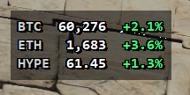

# HyperHUD

A tiny Hyperliquid price ticker that sits in the corner of your screen, like an FPS counter.
Built for keeping an eye on the market (and your positions) while gaming.



- BTC, ETH and HYPE prices with 24h change (any Hyperliquid perp can be added)
- Optional: your open positions, unrealized PnL and account value
- Click-through, always on top, hidden from the taskbar and Alt+Tab
- One hotkey to open and close it. While closed it makes no network calls
- One Python file, standard library only. Nothing to `pip install`

Windows only.

## Install

1. Install [Python 3](https://www.python.org/downloads/) (tick **Add python.exe to PATH**).
2. Download this repo (green **Code** button → **Download ZIP**) and unzip it.
3. In that folder, run:

   ```powershell
   powershell -ExecutionPolicy Bypass -File .\install.ps1
   ```

This copies HyperHUD to `%LOCALAPPDATA%\HyperHUD`, adds it to your Startup folder and Start menu, and launches it.

Uninstall with:

```powershell
powershell -ExecutionPolicy Bypass -File .\install.ps1 -Uninstall
```

Or skip the installer and just run `pythonw hyperhud.py`.

## Hotkeys

| Keys | Action |
| --- | --- |
| `Ctrl+Alt+H` | Show / hide |
| `Ctrl+Alt+Q` | Quit (start it again from the Start menu) |

## Settings

`config.json` is created next to `hyperhud.py` on first run (`%LOCALAPPDATA%\HyperHUD\config.json` if you used the installer). Quit with `Ctrl+Alt+Q` and relaunch after editing.

| Key | Default | What it does |
| --- | --- | --- |
| `coins` | `["BTC","ETH","HYPE"]` | Tickers to show (Hyperliquid perp names) |
| `wallet` | `""` | Your Hyperliquid address (`0x…`) to show positions. Read-only; no keys needed |
| `corner` | `"top-left"` | `top-left`, `top-right`, `bottom-left`, `bottom-right` |
| `offset_x`, `offset_y` | `12` | Distance from the screen edge in pixels |
| `font`, `font_size`, `bold` | `Consolas`, `12`, `true` | Text style |
| `opacity` | `1.0` | Opacity of the text |
| `backdrop_opacity` | `0.5` | Dark panel behind the text, `0` turns it off |
| `price_poll_seconds` | `2` | How often prices refresh |
| `positions_poll_seconds` | `3` | How often positions refresh |
| `show_24h_change` | `true` | Show the 24h % change |
| `show_positions` | `true` | Show positions when `wallet` is set |

## Games and fullscreen

HyperHUD shows on top of games running in **borderless windowed** or **windowed** mode.
Games in exclusive fullscreen draw over every other window, so switch those to borderless.

## How it works

It polls the public [Hyperliquid info API](https://hyperliquid.gitbook.io/hyperliquid-docs/for-developers/api/info-endpoint)
(`allMids` for prices, `metaAndAssetCtxs` for 24h change, `clearinghouseState` for positions) and draws
the text in a transparent, click-through Tk window. No API keys, no private keys, no telemetry.

## License

MIT
